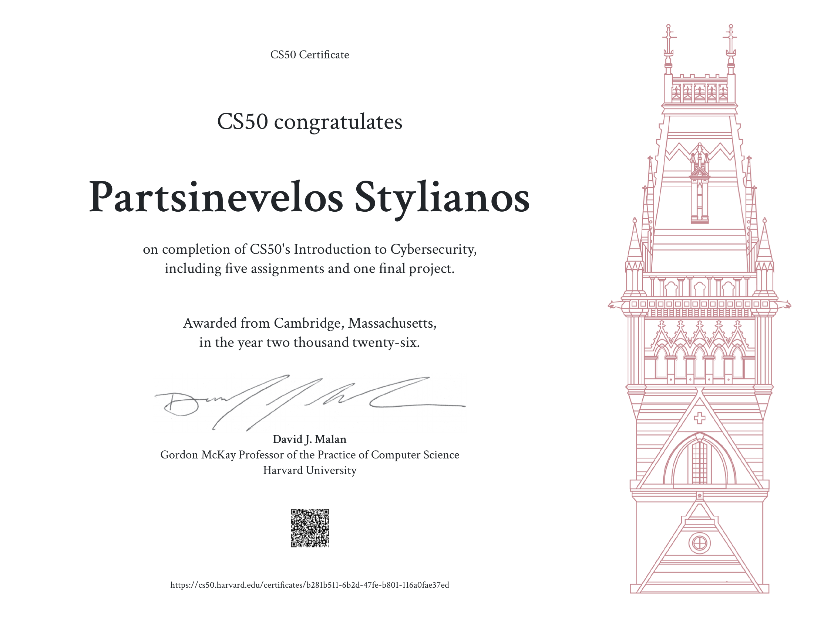

# Case Study: DeepSeek Database Exposure (CS50 Cybersecurity Final Project)

> Final project for **CS50's Introduction to Cybersecurity** (Harvard University, via edX): a case study of the January 2025 exposure of an unauthenticated ClickHouse database belonging to the AI company DeepSeek.
>
> **Student:** Stylianos Ioannis Partsinevelos · Athens, Greece · **edX:** partsi14 · **GitHub:** PARTSI14 · **Recorded:** 5 October 2026

## Video presentation

▶️ **Watch on YouTube:** https://www.youtube.com/watch?v=6DaInwM2Gig (7 min 26 s)
## Certificate

## About the project

The presentation (8 slides) analyses how a single misconfiguration at a fast-growing AI company left internal data open to anyone on the internet, and what defenders can learn from it. There was no software vulnerability and no CVE: the root cause was an **unauthenticated database exposed to the public internet**.

## Incident summary

| Item | Detail |
| --- | --- |
| Organisation | DeepSeek (Chinese AI company, maker of DeepSeek-R1) |
| Discovered by | Wiz Research, during an assessment of DeepSeek's internet-facing assets |
| Disclosed | 29 January 2025 (Wiz); DeepSeek secured the database promptly after disclosure |
| What was exposed | A ClickHouse database reachable on unusual open ports **8123** and **9000**, at `oauth2callback.deepseek.com:9000` and `dev.deepseek.com:9000` |
| Authentication | None: anyone could run SQL queries and had full control of database operations |
| Data | Over a million log lines in a `log_stream` table, from 6 January 2025: plaintext **chat history**, **API keys / secrets**, backend details, internal API endpoints and operational metadata |
| CVE | None (misconfiguration) |

## How it happened (simplified)

1. **Reconnaissance:** the researchers mapped DeepSeek's public subdomains and found two unusual open ports.
2. **Discovery:** the ports led to ClickHouse, an analytics database, with no password required.
3. **Access:** ClickHouse's HTTP interface allowed arbitrary SQL queries straight from a browser.
4. **Impact:** the logs contained user conversations and secrets; an attacker could also have tried privilege escalation inside DeepSeek's environment.

## Lessons for defenders

| Lesson | What it means in practice |
| --- | --- |
| Inventory your attack surface | Know every internet-facing host and port, including development systems (`dev.` subdomains) |
| Never expose databases directly | Databases belong on private networks; reach them through a VPN or bastion host |
| Require authentication everywhere | Default "no password" settings are acceptable only on isolated test systems |
| Don't log secrets | API keys and user conversations should not end up in plaintext logs |
| Move security as fast as the product | Rapid growth (DeepSeek-R1's launch) multiplies the cost of basic mistakes |
| Responsible disclosure works | Wiz reported privately and DeepSeek fixed it quickly |

## Repository contents

| File | Description |
| --- | --- |
| `README.md` | This document |
| CS50_certificate_linkedin.png | Course certificate |

## Sources

- [Wiz Research: Wiz Research Uncovers Exposed DeepSeek Database Leaking Sensitive Information, Including Chat History](https://www.wiz.io/blog/wiz-research-uncovers-exposed-deepseek-database-leak)
- [BleepingComputer: DeepSeek exposes database with over 1 million chat records](https://www.bleepingcomputer.com/news/security/deepseek-ai-exposed-databases-with-user-chat-history-api-keys/)
- [TechTarget: Wiz reveals DeepSeek database exposed API keys, chat history](https://www.techtarget.com/searchsecurity/news/366618594/Wiz-reveals-DeepSeek-database-exposed-API-keys-chat-histories)
- [The Register: DeepSeek left a database wide open](https://www.theregister.com/2025/01/30/deepseek_database_left_open/)
- [CS50's Introduction to Cybersecurity](https://cs50.harvard.edu/cybersecurity/)

## Academic honesty

This repository contains only my own final project. In line with CS50's academic honesty policy, it does not include solutions to the course's problem sets.

## License & attribution

© 2026 Stylianos Partsinevelos. Released under the MIT License (see [LICENSE](LICENSE)).

This case study is based on public reporting; all research credit for the discovery belongs to Wiz Research. Not affiliated with or endorsed by Harvard University, CS50, edX, DeepSeek or Wiz.
